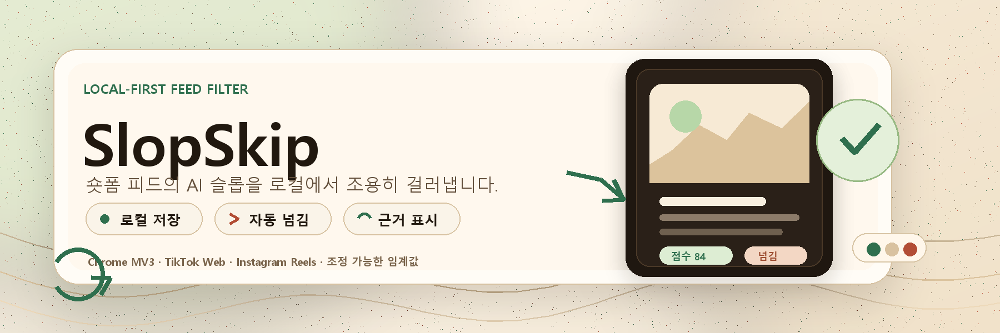

<div align="center">



# SlopSkip

**숏폼 피드의 AI 슬롭을 로컬에서 걸러내는 Chrome 확장 프로그램**

[](./manifest.json)
[](./tsconfig.json)
[](#개인정보와-로컬-우선-구조)
[](#개발)

[English](./README.md) · [설치](#빠른-시작) · [기능](#기능) · [개발](#개발) · [문서](#문서)

</div>

---

SlopSkip은 지원되는 숏폼 피드를 감시하고, 현재 게시물의 화면 신호를 점수화한 뒤, 기준을 넘으면 자동으로 다음 게시물로 넘길 수 있습니다. 원격 AI 판정기가 아니라, 사용자가 직접 조정하고 확인할 수 있는 개인 피드 필터입니다.

> **상태:** MVP / 계속 개선 중. TikTok Web과 Instagram Reels Web을 지원하며, Reels 안정성 개선에 가장 많은 작업이 들어가 있습니다.

## 목차

- [왜 SlopSkip인가](#왜-slopskip인가)
- [기능](#기능)
- [지원 플랫폼](#지원-플랫폼)
- [빠른 시작](#빠른-시작)
- [사용 방법](#사용-방법)
- [동작 방식](#동작-방식)
- [개인정보와 로컬 우선 구조](#개인정보와-로컬-우선-구조)
- [개발](#개발)
- [프로젝트 구조](#프로젝트-구조)
- [안정성 메모](#안정성-메모)
- [한계](#한계)
- [문서](#문서)

## 왜 SlopSkip인가

숏폼 플랫폼은 저품질 AI 콘텐츠를 사용자가 직접 제어하기 어렵습니다. SlopSkip은 반대 방향을 목표로 합니다.

- **로컬 우선:** 설정, 선택, 학습 신호가 브라우저 안에 남습니다.
- **확인 가능:** 선택적으로 디버그 UI를 켜서 점수 근거를 볼 수 있습니다.
- **조정 가능:** 임계값, 크리에이터 선택, 직접 키워드를 사용자가 바꿀 수 있습니다.
- **복구 가능:** 가져오기/내보내기, 초기화, 되돌리기, 수동 재방문 보호가 있습니다.
- **원격 AI 의존 없음:** MVP 단계에서는 페이지 내용을 외부 LLM이나 OCR 서비스로 보내지 않습니다.

## 기능

| 영역 | 제공 기능 |
| --- | --- |
| 피드 필터링 | 현재 게시물을 점수화하고, 기준을 넘으면 자동으로 넘깁니다. |
| Reels 지원 | 캡션/댓글 수집, 활성 릴 감지, 넘김 재시도, 전환 확인을 사용합니다. |
| 사용자 제어 | 필터 강도, 수동 재방문 일시정지, 크리에이터 허용/필터 선택을 제공합니다. |
| 직접 규칙 | 영어, 한국어, 공통 키워드 규칙을 상세 설정에서 추가할 수 있습니다. |
| 설명 가능성 | 팝업 이유 칩과 디버그 패널로 점수 출처와 넘김 breadcrumb를 보여줍니다. |
| 로컬 데이터 도구 | 보기, 복사, 다운로드, 가져오기, 초기화, 삭제, 되돌리기를 지원합니다. |
| 안정성 보강 | 확장 reload, 오래된 content script, 라우트 이탈, 저장소 레이스, 장시간 세션을 방어합니다. |

## 지원 플랫폼

| 플랫폼 | 상태 | 설명 |
| --- | --- | --- |
| TikTok Web | MVP | 보이는 게시물을 점수화하고 자동 넘김을 시도합니다. |
| Instagram Reels Web | 집중 개선 중 | 라벨, 캡션, 댓글, 해시태그, 크리에이터 신호를 읽고 여러 넘김 fallback을 사용합니다. |
| YouTube Shorts | 예정 | 아직 구현되지 않았습니다. |

## 빠른 시작

```bash
npm install
npm run build
```

Chrome에 확장 프로그램을 로드합니다.

1. `chrome://extensions`를 엽니다.
2. **개발자 모드**를 켭니다.
3. **압축해제된 확장 프로그램을 로드합니다**를 누릅니다.
4. `dist` 폴더를 선택합니다.
5. 다시 빌드한 뒤에는 열려 있는 TikTok 또는 Instagram 탭을 새로고침합니다.

## 사용 방법

1. TikTok Web 또는 Instagram Reels Web을 엽니다.
2. SlopSkip 확장 아이콘을 누릅니다.
3. **Auto-filter**를 켭니다.
4. 필터 강도를 선택합니다.
5. 필요하면 **Show reasons**를 켜서 점수 근거를 봅니다.
6. 현재 크리에이터를 항상 허용하거나 더 강하게 필터링하도록 표시합니다.

더 깊게 조정하려면 팝업에서 **Detailed settings**를 엽니다.

## 동작 방식

```text
지원 페이지
  → 플랫폼 어댑터가 활성 게시물을 찾음
  → 화면에 보이는 신호를 추출
  → 점수 엔진이 휴리스틱 + 로컬 규칙 + 피드백을 합산
  → 임계값을 넘으면 자동 넘김 여부 결정
  → 팝업/상세 설정/디버그 UI에서 설명과 조정 제공
```

현재 사용하는 신호는 다음과 같습니다.

- 공식 AI 라벨 또는 AI 사용 고지 문구
- 캡션과 해시태그
- AI, fake, slop, render, CGI 관련 댓글 반응
- 한국어와 영어 중심 문구 패턴
- “AI가 아니다” 같은 반대 신호
- 크리에이터별 허용/필터 선택
- 로컬에서 학습된 문구 점수
- 직접 키워드 목록

## 개인정보와 로컬 우선 구조

SlopSkip은 사용자의 제어권을 로컬에 두도록 설계되어 있습니다.

- 설정은 `chrome.storage.local`에 저장됩니다.
- 크리에이터 선택과 학습된 문구 점수는 브라우저 안에 남습니다.
- 직접 키워드 규칙도 브라우저 안에 저장됩니다.
- MVP 단계에서는 페이지 내용을 원격 AI 서비스로 보내지 않습니다.
- MVP 단계에서는 원격 OCR 또는 원격 LLM 파이프라인을 사용하지 않습니다.

## 권한

| 권한 | 필요한 이유 |
| --- | --- |
| `storage` | 로컬 설정, 크리에이터 선택, 학습 점수, 직접 규칙을 저장합니다. |
| `https://www.tiktok.com/*` | TikTok Web의 화면 신호를 읽고 넘김 동작을 시도합니다. |
| `https://www.instagram.com/*` | Instagram Web의 Reels 신호를 읽고 넘김 동작을 시도합니다. |

## 개발

```bash
npm install
npm run build
npm run watch
npm run typecheck
npm test
```

| 명령어 | 설명 |
| --- | --- |
| `npm run build` | Chrome 확장 프로그램을 `dist`에 빌드합니다. |
| `npm run watch` | 개발 중 변경사항을 감시하며 다시 빌드합니다. |
| `npm run typecheck` | TypeScript 타입 검사를 실행합니다. |
| `npm run test:scoring` | 점수화 스모크 테스트를 실행합니다. |
| `npm run test:storage` | 저장소 마이그레이션과 일관성 테스트를 실행합니다. |
| `npm test` | 타입 검사, 점수화 테스트, 저장소 테스트를 모두 실행합니다. |

## 프로젝트 구조

```text
src/background      백그라운드 메시지 처리
src/content         content script, 어댑터, 점수화, 넘김 로직, 디버그 UI
src/options         상세 설정 대시보드
src/popup           빠른 제어 팝업
src/shared          공통 상수, 타입, 저장소, i18n, UI 헬퍼
scripts             빌드와 스모크 테스트 스크립트
docs                구조, 셀렉터, Reels probe, 테스트 문서
_locales            Chrome i18n 메시지
public              dist로 복사되는 확장 프로그램 자산
```

## 안정성 메모

실제 피드의 지저분한 동작을 버티기 위해 다음 방어 로직을 포함합니다.

- 확장 reload 뒤 `Extension context invalidated` 정리
- 오래된 content script 인스턴스 감지
- Reels 전환 확인과 재시도 예약
- Reels 버튼, 키보드, 휠, 스크롤 기반 넘김 fallback
- 로컬 업데이트 유실을 막는 저장소 쓰기 직렬화
- 저장 중간의 낡은 상태를 읽지 않도록 하는 대기 읽기
- 지원 페이지 밖으로 이동했을 때 점수와 디버그 패널 정리
- 긴 브라우징 세션을 위한 인메모리 아이템 추적 상한
- 가져온 임계값, 규칙, 선택, 학습 점수 정규화

## 한계

- 휴리스틱 기반이므로 오탐과 미탐이 모두 생길 수 있습니다.
- 플랫폼 DOM 변경으로 셀렉터나 넘김 동작이 깨질 수 있습니다.
- Instagram이 스크롤 또는 키 이벤트를 가로채면 Reels 전환이 실패할 수 있습니다.
- 댓글 수집은 현재 페이지 UI가 노출하는 내용에 의존합니다.
- SlopSkip은 개인 필터 도구이지, 콘텐츠 검열 시스템이나 진실 판정기가 아닙니다.

## 문서

- [`docs/architecture.md`](./docs/architecture.md)
- [`docs/plan.md`](./docs/plan.md)
- [`docs/selectors.md`](./docs/selectors.md)
- [`docs/reels-probe-report.md`](./docs/reels-probe-report.md)
- [`docs/testing.md`](./docs/testing.md)

## 기여

이 저장소는 아직 초기 단계이며 의도적으로 작게 유지하고 있습니다. 변경을 보내기 전에는 다음 기준을 지켜주세요.

1. 필터링 동작은 설명 가능하고 사용자가 제어할 수 있어야 합니다.
2. 로컬 우선 저장을 선호하고, 원격 콘텐츠 처리는 피합니다.
3. `npm test`와 `npm run build`를 실행합니다.
4. 사용자에게 보이는 동작 변화는 README 또는 `docs/`에 기록합니다.

## 라이선스

현재 라이선스 파일은 포함되어 있지 않습니다. 이 프로젝트를 재사용하거나 재배포하려면 먼저 이슈를 열거나 라이선스를 추가해야 합니다.
